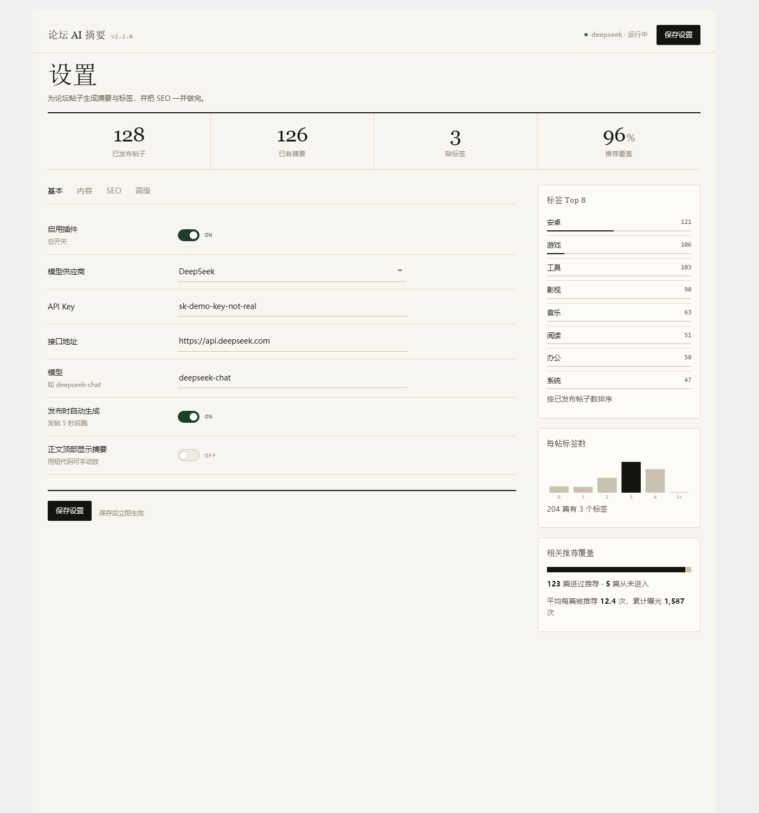

# 论坛 AI 摘要 · Forum AI Summary

[](LICENSE)
[](https://wordpress.org/)
[](https://www.php.net/)
[](readme.txt)

> 为子比（Zibll）论坛帖子自动生成 AI 摘要与相关标签，并把 SEO 一次做完。

给论坛帖子生成**内容摘要**与**相关标签**，写入子比「独立SEO」三要素，为标签与板块补搜索描述，在正文里做语义内链，在文末挂相关推荐。发帖自动跑，失败自动重试，标题改动后自动重整理 SEO。

---

## 特性

| 功能 | 说明 | 触发方式 |
| --- | --- | --- |
| AI 摘要 + 标签 | 生成摘要与 3 个（可配 1–10）相关标签；标签只复用站内已有 `forum_tag`，不新建 | 发布后 5 秒 / 编辑页手动 |
| AI SEO 三要素 | 生成 SEO 标题、关键词、描述，写入子比「独立SEO」字段，不改帖子原标题 | 首次生成时一并执行 |
| 标题变更重整理 | 帖子标题改动后自动重跑 AI SEO（版本号更新等场景） | 保存后 10 秒 |
| 搜索摘要补全 | 给标签归档页、板块页补 `meta description`（60–120 字） | 发帖 / 新建标签后 8 秒 |
| 相关推荐 | 正文下方横向卡片：同标签 → 关键词 → 同板块 → 兜底，支持曝光均衡 | 前台渲染 + 缓存 |
| 正文自动内链 | AI 从站内选最相关的一篇，在正文里给一个**本来就有**的词加链接 | 摘要生成后 10 秒（默认关闭） |
| 泛词标签 noindex | 命中清单（默认 工具/娱乐/系统/下载）的标签页输出 `noindex,follow` | 前台 `wp_robots` |
| 新标签拼音别名 | 新建标签时把中文名转成拼音 slug（`电视直播` → `dian-shi-zhi-bo`） | 仅新标签，存量不动 |
| 存量补齐 | 一键给没有摘要的已发布帖子逐篇补摘要，带进度、可停止 | 设置页「内容」页签 |
| 旧标签 301 | 已被合并或删除的旧标签 URL 301 到主标签 | 前台 `template_redirect` |

- 支持 **OpenAI / DeepSeek / Anthropic**，以及任意兼容 OpenAI 协议的接口。
- 只作用于论坛帖子（`forum_post`），不影响普通文章与页面。
- 无前端框架、无 CDN、无构建步骤，可离线运行。

## 截图



> 设置页：米白纸面、衬线大数字、吸顶毛玻璃顶栏；右栏为标签分布与相关推荐覆盖的实时统计。

## 环境要求

| 项目 | 要求 |
| --- | --- |
| WordPress | 5.8 及以上 |
| PHP | 7.4 及以上 |
| 主题 | 子比（Zibll）V6+，且已开启「社区 & 论坛」 |
| 其他 | 无需 bbPress、无需 Composer / Node |

## 安装

**方式一：上传压缩包**

1. 后台「插件 → 安装插件 → 上传插件」，选择 `forum-ai-summary.zip`。
2. 启用「论坛 AI 摘要」。

**方式二：命令行**

```bash
cd wp-content/plugins
git clone https://github.com/2788127358/forum-ai-summary.git
```

然后在后台启用插件。

## 快速开始

1. 打开「论坛AI摘要 → 设置 → 基本」，选择模型供应商，填写 **API 密钥 / 接口地址 / 模型**，保存。
2. 发一篇新帖，5 秒后回到帖子列表，能看到摘要与标签已生成。
3. 历史帖子：进「内容」页签，点「一键补齐」逐篇补摘要（可随时停止）。
4. 想核对 SEO 是否生效：看前台页面的 `<title>` 与 `meta description`，或用「高级 → 系统检测」里的字段探测。

## 后台界面

单页、四个页签，右侧常驻数据栏：

| 区域 | 内容 |
| --- | --- |
| 顶栏（吸顶） | 插件名与版本、当前供应商与运行状态、保存按钮 |
| 数据条 | 已发布帖子 / 已有摘要 / 缺标签 / 推荐覆盖 |
| 页签 | 基本 · 内容 · SEO · 高级 |
| 右栏 | 标签 Top 8、每帖标签数分布、相关推荐覆盖 |

- 样式全部限定在 `.fas-admin` 作用域，不污染其它后台页面。
- 顶栏使用 `backdrop-filter` 毛玻璃；不支持时自动退回实色。
- 动效遵循 `prefers-reduced-motion`，系统开启「减少动态效果」时全部关闭。

## 工作流程

```
发布/更新为已发布
      │  transition_post_status
      ▼
  +5s  fas_generate_event ──► 生成摘要与标签 ──► 顺带生成 AI SEO
                                      │
                                      └─ +10s  fas_ilink_auto_event（默认关闭）

帖子标题被修改
      │  post_updated（比较改前/改后标题）
      ▼
  +10s  fas_seo_retitle_event ──► 重跑 AI SEO

新建标签
      ├─ +8s  fas_desc_auto_event ──► 补标签搜索描述
      └─ created_term ──► 生成拼音别名
```

生成失败时按 `retry_delay × 次数` 退避重试，超过 `max_retries` 记为失败并停止自动重试（仍可在编辑页手动重跑）。

## 数据存储

| 类型 | 键 | 说明 |
| --- | --- | --- |
| option | `fas_options` | 全部插件配置（单个数组） |
| option | `fas_tag_merge_map` | 旧标签 → 主标签映射（301 依赖，勿删） |
| option | `fas_db_version` | 结构迁移标记 |
| post meta | `_fas_summary` / `_fas_tags` / `_fas_status` / `_fas_error` | 生成结果与状态 |
| post meta | `_fas_seo_title` / `_fas_seo_keywords` / `_fas_seo_description` / `_fas_seo_source_title` | AI SEO 记录 |
| post meta | `_fas_ilink` / `_fas_rel_imp` | 内链映射 / 推荐曝光计数 |
| term meta | `zib_other_data['term_seo']['description']` | 标签描述（与原生 description 双写） |

> 卸载插件不会自动删除这些数据，便于重新安装后继续使用；如需彻底清除，请手动删除对应 option 与 meta。

## 目录结构

```
forum-ai-summary/
├── forum-ai-summary.php          主入口
├── readme.txt                    WordPress 插件说明
├── README.md                     本文件
├── INSTALL.md                    设计与配置详解
├── includes/
│   ├── class-fas-forum.php       子比论坛适配层
│   ├── class-fas-options.php     配置管理
│   ├── class-fas-api.php         多模型 API 客户端
│   ├── class-fas-generator.php   摘要/标签生成核心
│   ├── class-fas-hooks.php       发布监听、cron、前端展示
│   ├── class-fas-admin.php       后台设置页
│   ├── class-fas-batch.php       单篇 Meta Box、存量补齐、右栏统计
│   ├── class-fas-title.php       AI SEO
│   ├── class-fas-seo-description.php 标签/板块描述
│   ├── class-fas-related.php     相关推荐 + 内链均衡
│   ├── class-fas-auto-link.php   正文语义内链
│   ├── class-fas-tag-policy.php  301 与泛词 noindex
│   ├── class-fas-slug.php        新标签拼音别名
│   ├── class-fas-tags.php        标签清洗
│   └── data/pinyin-map.php       拼音映射表（生成文件）
└── assets/ (css, js)
```

## 常见问题

**需要安装 bbPress 吗？**
不需要，直接对接子比主题自带的论坛系统。

**会改动帖子原标题吗？**
不会。AI 只写子比的「独立SEO」字段，帖子标题保持原样。

**AI 会自己创建新标签吗？**
不会。标签只与站内已有 `forum_tag` 匹配，命中才写入。

**支持哪些模型？**
OpenAI、DeepSeek、Anthropic，以及任何兼容 OpenAI 协议的接口（自填地址与模型名）。

**为什么有些帖子没有摘要？**
内容短于「最小输入字数」时会写入固定文案并标记为「已跳过」，不调用 API。可在「高级」里调整阈值。

**旧标签 URL 为什么会 301？**
标签被合并或删除后，插件读取 `fas_tag_merge_map` 把旧地址跳到主标签，避免外链失效。

## 开发

- 纯 PHP，无构建步骤；后台样式与脚本均为手写，无第三方依赖。
- 新增配置项必须同步三处：`FAS_Options::defaults()`、`FAS_Admin::sanitize()` 白名单、设置页字段。
- 延迟事件（cron）执行前都要做二次校验：对象仍存在、状态与开关仍满足。
- 分批处理使用「后端一次算出固定 ID 列表、前端按序回传」，不要每批重查列表。

## 贡献

欢迎 Issue 与 PR。提交 PR 前请：

1. 说明改动目的与影响范围（是否影响已有数据）。
2. 确认 `php -l` 通过，后台脚本 `node --check` 通过。
3. 涉及行为的改动请附带可复现的验证步骤。

## 许可

GNU General Public License v3.0，见 [LICENSE](LICENSE)。

## 作者

**开源极界** · <https://yd.zlinlang.com/>
